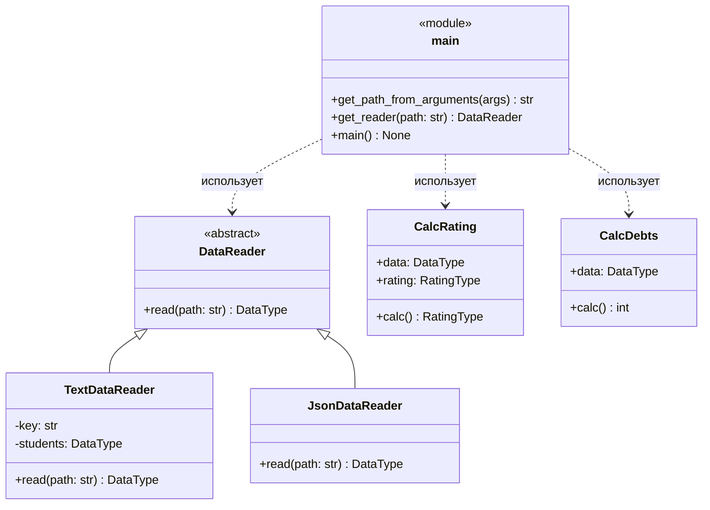

# Лабораторная работа № 1. Git и CI/CD GitHub Actions

Дисциплина «Технологии программирования».
Индивидуальный вариант — № 4 (формат JSON, подсчёт студентов с
академическими задолженностями).

## Постановка задачи

Разработать проект `rating`, рассчитывающий средний рейтинг студентов по
дисциплинам, и организовать для него хранение версий в Git и
автоматизированное тестирование в GitHub Actions.

Общие требования:

- чтение исходных данных о студентах и оценках из файла;
- расчёт среднего рейтинга каждого студента;
- модульные тесты (`pytest`), проверка оформления кода (`pycodestyle`);
- CI-сборка, запускаемая при каждом push в ветку `main`.

Индивидуальное задание (вариант 4):

- реализовать класс — наследник `DataReader`, читающий данные в формате
  **JSON**;
- реализовать класс, рассчитывающий **количество студентов, имеющих
  академические задолженности** (балл < 61 хотя бы по одному предмету), и
  вывести результат на экран;
- добавить файл лицензии и `.gitignore`;
- построить UML-диаграмму классов;
- каждый пункт выполнять в отдельной ветке с последующим слиянием в `main`.

## Краткое описание проекта

Программа читает файл со списком студентов и их оценками, вычисляет средний
рейтинг каждого студента и количество студентов с задолженностями.

Формат данных — «студент → список пар (дисциплина, балл)». Для чтения разных
форматов используется шаблон «Стратегия»: абстрактный класс `DataReader`
задаёт интерфейс `read(path)`, а конкретные реализации `TextDataReader` и
`JsonDataReader` читают `.txt` и `.json` соответственно. Выбор реализации
выполняется в `main.py` по расширению входного файла, поэтому добавление
нового формата не затрагивает код расчётов.

Пример текстового файла (`data/data.txt`):

```text
Иванов Иван Иванович
    математика:80
    программирование:90
    литература:76
```

Пример JSON-файла (`data/data.json`):

```json
{
    "Иванов Иван Иванович": {
        "математика": 67,
        "литература": 100,
        "программирование": 91
    }
}
```

Пример запуска:

```text
$ python src/main.py -p data/data.json
Students:  {'Иванов Иван Иванович': [('математика', 67), ...], ...}
Rating:  {'Иванов Иван Иванович': 86.0, ...}
Students with debts:  1
```

Студент с баллом ровно 61 задолженности не имеет: задолженностью считается
балл строго меньше 61.

## Структура проекта

```text
rating
  |----.github
  |     |----workflows
  |           |----github-actions-testing.yml
  |
  |----data
  |     |----data.txt
  |     |----data.json
  |
  |----src
  |     |----CalcDebts.py
  |     |----CalcRating.py
  |     |----DataReader.py
  |     |----JsonDataReader.py
  |     |----TextDataReader.py
  |     |----Types.py
  |     |----main.py
  |
  |----test
  |     |----test_CalcDebts.py
  |     |----test_CalcRating.py
  |     |----test_JsonDataReader.py
  |     |----test_TextDataReader.py
  |     |----test_main.py
  |
  |----.gitignore
  |----LICENSE
  |----README.md
  |----requirements.txt
```

## Используемые языки, библиотеки и технологии

- Python 3 (типизация через `Type Hints`, ABC — абстрактные базовые классы);
- `json` — чтение JSON-файлов (стандартная библиотека);
- `pytest` — модульное и интеграционное тестирование;
- `pycodestyle` — проверка соответствия кода PEP 8;
- Git и GitHub — хранение версий, ветвление, слияние;
- GitHub Actions — CI: установка зависимостей, линтер, тесты при push в `main`;
- лицензия MIT.

## Запуск и тестирование

```bash
pip install -r requirements.txt
python src/main.py -p data/data.txt
python src/main.py -p data/data.json
```

Проверка стиля и запуск тестов:

```bash
pycodestyle src test
PYTHONPATH=./:./src pytest test
```

В Windows разделитель путей в `PYTHONPATH` — точка с запятой:
`$env:PYTHONPATH = ".;src"`.

Текущее состояние: 19 тестов, все проходят, покрытие кода — 97 %
(`pytest --cov=src`).

## CI/CD в GitHub Actions

Файл `.github/workflows/github-actions-testing.yml` запускает сборку при
каждом push в ветку `main` на `ubuntu-latest` с Python 3.10:

1. получение кода (`actions/checkout`);
2. установка Python (`actions/setup-python`);
3. установка зависимостей из `requirements.txt`;
4. проверка стиля `pycodestyle src test`;
5. запуск тестов `PYTHONPATH=./:./src/ pytest test`.

Сборка считается успешной только при отсутствии ошибок стиля и падений
тестов. Поведение конвейера при ошибке проверено локально: после намеренного
внесения ошибки в `CalcRating` тесты падали, после исправления — снова
проходили.

## UML-диаграмма классов



`DataType = dict[str, list[tuple[str, int]]]` — общий тип входных данных,
`RatingType = dict[str, float]` — результат расчёта рейтинга.

## Ход выполнения индивидуального задания

1. **Лицензия.** Добавлена лицензия MIT (`LICENSE`).
2. **.gitignore.** Исключены кэш Python, виртуальные окружения, отчёты
   покрытия и файлы IDE.
3. **Чтение JSON.** В ветке `feature/json-data-reader` добавлен
   `JsonDataReader` и выбор читателя по расширению файла в `main.py`,
   написаны тесты на чтение (включая пустой файл) и на выбор читателя.
4. **Расчёт задолженностей.** В ветке `feature/debts-counter` добавлен
   `CalcDebts`, тесты (включая граничное значение 61) и вывод результата в
   `main.py`.
5. **Интеграционные тесты.** В ветке `feature/main-integration-tests`
   добавлена проверка полного сценария запуска для `.txt` и `.json`.
6. Каждая ветка после успешного прохождения тестов слита в `main`
   (`git merge --no-ff`), история сохраняет отдельные коммиты по задачам.

## Выводы

В ходе работы освоены основные команды Git (`init`, `add`, `commit`,
`branch`, `merge`, `remote`, `push`), модель ветвления для параллельной
разработки и порядок слияния веток в основную. Настроен CI-конвейер GitHub
Actions, который при каждом push автоматически проверяет стиль кода и
запускает тесты, что позволяет обнаруживать регрессии до попадания кода в
основную ветку.

Проект построен на принципе открытости/закрытости: новый формат данных
добавляется отдельным наследником `DataReader` без изменения классов
расчётов, а тесты покрывают как отдельные классы, так и сценарий запуска
целиком. Отдельный результат — разбор особенности импортов: при
одновременном использовании `PYTHONPATH=src` и пакетных импортов вида
`src.module` модуль может загружаться дважды, поэтому проверки в тестах
построены на поведении объектов, а не на идентичности классов.

## Лицензия

Проект распространяется по лицензии MIT — см. файл [LICENSE](LICENSE).
